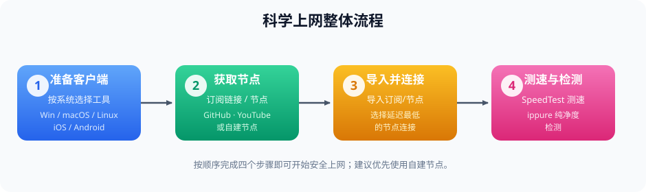
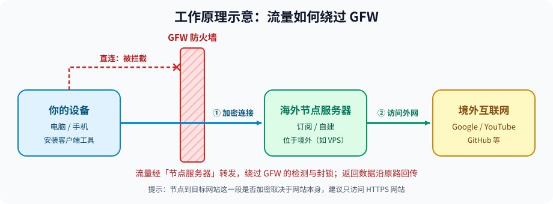

# 普通人如何从零开始绕过 GFW（科学上网）教程

> **⚠️ 免责声明：** 本文章仅作教学与技术交流用途。请遵守你所在国家 / 地区的法律法规，因使用本文内容产生的一切后果由使用者自行承担。

本教程面向没有任何基础的普通用户，手把手带你了解如何准备工具、获取节点并安全地连接网络。请务必阅读文末的**安全建议**与**合规建议**。

下图展示了从准备到上线的四个步骤：



## 📑 目录

- [快速开始（太长不看版）](#快速开始太长不看版)
- [一、准备工作](#一准备工作)
- [二、获取节点信息以及订阅链接](#二获取节点信息以及订阅链接)
- [三、开始使用](#三开始使用)
- [四、安全与隐私建议](#四安全与隐私建议)
- [五、常见问题排查](#五常见问题排查)
- [六、给中国大陆用户的建议](#六给中国大陆用户的建议)

---

## 快速开始（太长不看版）

1. 按你的系统，在 [一、准备工作](#一准备工作) 中选一个客户端，**从项目官方 GitHub 仓库的 Releases 页面下载**；
2. 按 [二、获取节点信息以及订阅链接](#二获取节点信息以及订阅链接) 获取节点（**优先自建**）；
3. 把节点 / 订阅链接导入客户端，选延迟最低的节点连接；
4. 用 SpeedTest 测速、用 ippure 检测 IP 纯净度，并阅读 [四、安全与隐私建议](#四安全与隐私建议)。

---

## 一、准备工作

你需要准备一个**客户端工具**。以下工具任选其一即可，大部分工具都可以在 GitHub 上查找并下载。

| 平台 | 推荐客户端 |
| :--- | :--- |
| **Windows** | **v2rayN**、**Clash Verge Rev**、**Clash Party**、**nekoray**、**Hiddify App**、**Karing**、**sing-box** |
| **Linux** | **v2rayN**、**Clash Verge Rev**、**Clash Party**、**nekoray**、**Hiddify App**、**Karing**、**sing-box** |
| **macOS** | **Clash Verge Rev**、**Clash Party**、**Hiddify App**、**Karing**、**V2rayU**、**sing-box** |
| **iOS** | **Shadowrocket** |
| **Android** | **v2rayNG**、**Clash Meta For Android**、**NekoBox For Android**、**sing-box**、**Hiddify App**、**FlClash**、**Karing** |

> **💡 提示（iOS 用户）：** Shadowrocket 需要**美区 Apple ID**，且需支付 $2.99（HK$22）。该软件为**一次性付费**，后续更新免费。

> **🔒 下载安全：** 请只从项目**官方 GitHub 仓库的 Releases 页面**下载客户端。不要点击搜索结果中的广告链接，也不要下载来路不明的"破解版 / 整合版"——假冒客户端是窃取账号密码最常见的手段之一。
>
> 另外，客户端项目可能会停止维护或更名，选择前建议先看一眼仓库的最近更新时间，优先选择仍在活跃维护的项目。

---

## 二、获取节点信息以及订阅链接

获取节点 / 订阅链接主要有以下四种方式：

### 1. 通过 GitHub 搜索

在 **GitHub** 搜索你所使用客户端对应的「**节点**」「**订阅链接**」。

> **示例（以 v2ray 为例）：** 在 GitHub 搜索「*v2ray 节点*」「*v2ray 订阅链接*」。

### 2. 通过 YouTube / Google 搜索

在 **YouTube**、**Google** 搜索「**免费节点**」「**订阅链接**」。

> **示例（以 v2ray 为例）：** 在 **YouTube** / **Google** 搜索「*免费节点*」「*免费订阅链接*」。

> **⚠️ 风险提示：** 公开的免费节点由陌生人运营，运营者理论上可以看到你的**访问目标（域名 / IP）和流量大小**，部分节点还可能被用来做流量劫持。**只用来浏览公开信息，不要登录银行、支付、邮箱、工作账号等敏感服务。**

### 3. 自建节点（推荐）

- 具体自建教程可参考 **GitHub** 上的 [**edgetunnel**](https://github.com/cmliu/edgetunnel) 项目；
- 或在 **YouTube** 搜索「***edgetunnel* 自建节点教程**」。

> **📺 视频参考：** 可参考 **零度解说** 的 [这期视频](https://www.youtube.com/watch?v=chcFg878840&list=PLBcRkTWd5jt7-yED9UXjnPz6tzyoV_YwZ&index=14&t=699s)。
>
> **📄 图文参考：** 若在中国大陆境内，可参考 **零度博客** 的 [这篇文章](https://www.freedidi.com/23618.html) 或 **官方** 的 [**图文教程**](https://blog.cmliussss.com/p/edt2/)。

> **📌 注意：** 自建节点依赖第三方平台（如 Cloudflare）的免费服务，请阅读并遵守该平台的服务条款，滥用有被限制或封号的风险。自建节点也不会因此变得"绝对安全"，仍请遵守第四章的安全建议。

### 4. 直接使用现成的示例节点

如果你还没有自己的节点，也可以直接复制下面提供的示例节点，按 [三、开始使用](#三开始使用) 的步骤导入客户端即可**临时测试**：

```text
vless://d9f20a29-239e-46ab-82bb-fa0d69e480f9@cf.3666888.xyz:443?encryption=none&security=tls&sni=proxy-3o9.pages.dev&fp=chrome&ech=cloudflare-ech.com%2Bhttps%3A%2F%2Fdns.alidns.com%2Fdns-query&type=ws&host=proxy-3o9.pages.dev&path=%2Fpicture%2Farchives#%E5%A4%A7%E4%BD%AC%E7%BB%B4%E6%8A%A4%20%7C%20HuTao
```

> **📌 说明：** 该节点为 **VLESS + TLS(ECH) + WebSocket**，需要使用支持 **ECH** 的较新版本客户端（如 **v2rayN**、**Clash Verge Rev**、**sing-box** 等）。公开示例节点的时效性无法保证，且会被很多人同时使用，速度和稳定性都可能不理想；若无法连接，请改用自建节点或其他节点。

> **⚠️ 重要提醒：** 通过 GitHub、YouTube 获取的节点具有时效性，强烈建议自建一个节点作为备用，也建议将自建节点作为主力使用。

---

## 三、开始使用

下图说明了客户端如何通过「节点服务器」将流量转发至境外，从而绕过 GFW 的检测：



当获取到*节点信息*或*订阅链接*后，按以下步骤操作：

1. 将其**导入**至所选的客户端工具中：
   - **单个节点链接**（如 `vless://...`）：复制后，在客户端中选择「从剪贴板导入」；
   - **订阅链接**（`https://...`）：在客户端的「订阅 / 配置」页面新增订阅，粘贴链接并**更新订阅**；
2. 选择**延迟最低**的节点进行连接（多数客户端提供「测延迟 / 测速」功能）；
3. 开启**系统代理**（或 **TUN / 虚拟网卡模式**，以便让不读取系统代理的软件也走代理）；
4. 连接成功后，推荐使用 [**SpeedTest**](https://www.speedtest.net/zh-Hans) 进行测速；
5. 推荐使用 [**ippure**](https://ippure.com/) 进行 IP 纯净度检测。

> **⚠️ 注意：** 从 **GitHub** / **YouTube** 获取的免费节点，以及使用 **edgetunnel** 自建的节点，其纯净度通常不会太高，请勿用于重要用途以及上传敏感重要信息。

---

## 四、安全与隐私建议

- **只访问 HTTPS 网站**：这样即使节点运营者也无法看到你的页面内容；
- **不要在不可信的节点上登录**银行、支付、工作邮箱等敏感账号，也不要在其上输入密码；
- **定期更新客户端**：新版本通常包含协议支持与安全修复；
- **检查是否存在 DNS 泄漏**：连接后可使用 DNS 泄漏检测网站（如 dnsleaktest.com、browserleaks.com）自查，避免域名查询仍然走本地网络；
- **订阅链接等同于"密码"**：不要把自己的订阅链接和自建节点配置（含 UUID / 密码）发到公开场合，否则很容易被滥用或封禁；
- **使用完毕或怀疑泄露时**，及时更换节点配置（例如重置 UUID / 密码）。

---

## 五、常见问题排查

| 现象 | 可能原因 / 解决办法 |
| :--- | :--- |
| 导入后所有节点超时 | 节点已失效或订阅已过期：先**更新订阅**，再换节点 / 换订阅源 |
| 提示 TLS / 证书错误 | 先检查**系统时间**是否准确（建议开启自动校时）；其次检查节点配置里的 SNI / Host 是否填写正确 |
| 示例节点无法连接 | 客户端版本过旧、**不支持 ECH**：升级到最新版，或换用 v2rayN / Clash Verge Rev / sing-box |
| 能连接但只有部分软件能上网 | 部分软件不读取系统代理：改用 **TUN / 虚拟网卡模式** |
| 速度慢 / 不稳定 | 免费节点人多拥挤：换节点，或改用自建节点 |
| 某些网站仍然访问不了 | 检查客户端的**分流规则**（全局 / 规则 / 直连）是否选择正确，或更新规则集 |
| 某个服务提示"代理 / VPN 异常" | 该节点 IP 纯净度较低，被目标服务识别：更换节点或使用自建节点 |

---

## 六、给中国大陆用户的建议

> 本篇教程**仅做教学用途**，请勿违反中国大陆的法律，否则**后果自负**。

- 绕过 GFW 后，请勿发表不良政治言论，以免对本国造成不良影响，以及危害自身安全；
- 请使用 **GitHub 开源** 的输入法（如 Rime 系列）或 **Google 输入法**，避免输入内容被上传；
- 请避免使用**中国大陆**的邮箱和**手机号**注册海外服务，以免带来*不必要的麻烦*；
- 若想进行跨境电商，请选择**正规节点厂家**购买，以追求更高的 IP 纯净度和隐私安全；
- 若想在不违反本国法律的前提下进行跨境电商，可选择**中国大陆三大运营商**提供的**国际专线**（仅正规企业可申请，个人无权申请）：

| 运营商 | 国际专线申请入口 |
| :--- | :--- |
| 中国电信 | [点击申请](https://zh-hans.chinatelecomeurope.com/%E4%BA%A7%E5%93%81%E4%B8%8E%E6%9C%8D%E5%8A%A1/%E5%9B%BD%E9%99%85%E4%B8%93%E7%BA%BF/) |
| 中国移动 | [点击申请](https://www.cmi.chinamobile.com/sc) |
| 中国联通 | [点击申请](https://www.cuguplus.com/zh-hans/subsidiaryContact) |
